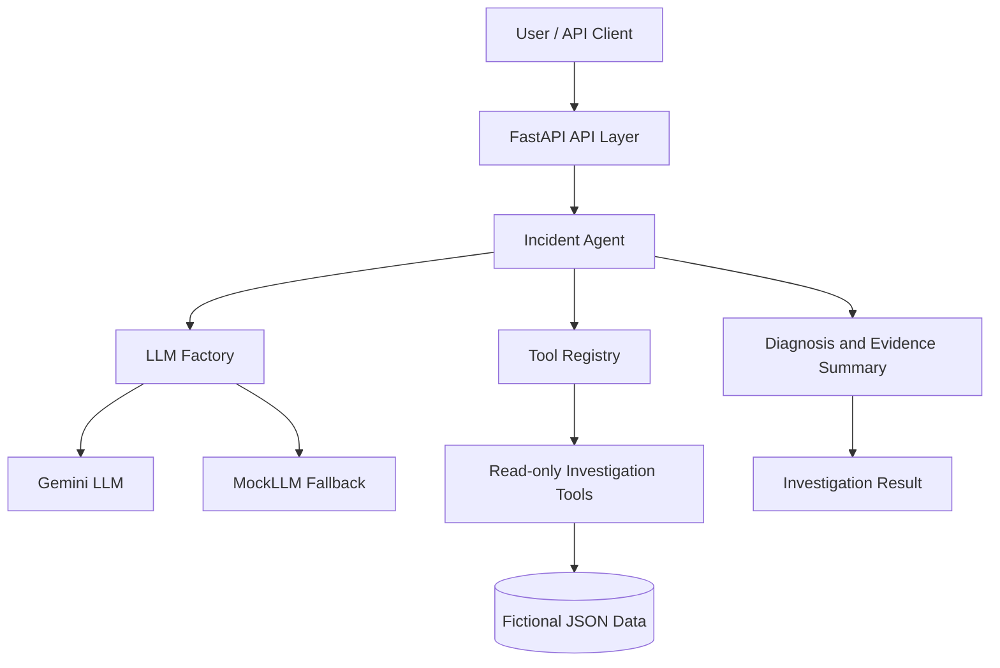
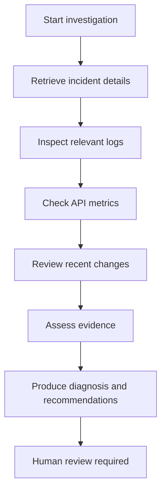

# AI Integration Incident Agent

An AI-assisted incident investigation prototype that gathers evidence from mock integration systems, identifies likely causes, and recommends remediation for human review.

The project demonstrates agent orchestration, tool calling, REST API foundations, evidence-based diagnosis, and a human-in-the-loop safety boundary. All incident records and system data are fictional.

## Architecture



The agent selects an investigation tool based on the evidence gathered so far. The agent—not the language model—validates and executes the selected tool through the tool registry. The tools read fictional incident, log, API metric, and change data.

## Investigation workflow



The agent can request additional evidence before finishing. The final result includes the evidence collected, likely root cause, impact, recommended next steps, confidence, and a flag indicating that human approval is required.

## Example scenario

Incident `INC-1001` reports HTTP 429 responses from the fictional Customer Sync API.

The investigation finds:
- Request volume exceeded the configured rate limit.
- Logs show rate-limit warnings, HTTP 429 responses, and rejected sync requests.
- API metrics report a degraded status and an elevated error rate.
- A recent configuration change increased the batch size from 100 to 250 records.

The resulting diagnosis identifies rate limiting as the likely cause and recommends reducing request pressure and considering throttling or exponential backoff. The batch-size change is relevant evidence, but is not treated as proven to be the sole cause.

See [`docs/sample-output.txt`](docs/sample-output.txt) for a sample run using `MockLLM`.

## Design and safety considerations

- **LLM fallback:** Uses the configured LLM when available and retains `MockLLM` as a fallback when real-LLM configuration or access is unavailable.
- **Controlled tool execution:** The model proposes an action; application code validates the tool name and arguments and executes it through the registry.
- **Human oversight:** The diagnosis marks human approval as required. This prototype does not implement an approval UI or automatically apply remediation.
- **Read-only investigation:** Tools inspect mock data; they do not change production systems.
- **Data safety:** Uses fictional data only. No employer or production information is included.

## Current scope and limitations

This is a portfolio prototype, not a production incident-management system. The investigation uses a small set of predefined tools and fictional JSON data. LLM output can vary, and diagnosis quality depends on the evidence available. Recommendations should be reviewed by a person before any operational action is taken.

## Run locally

Create and activate a Python virtual environment, install the dependencies in `requirements.txt`, and configure any optional LLM credentials using the example environment file. Keep real credentials in `.env` and never commit them.

Run the FastAPI application from the project root:

```powershell
python -m uvicorn src.incident_agent.api:app --reload
```

The health endpoint is available at `/health`. To test the investigation with the deterministic mock model, set `LLM_PROVIDER=mock` in your local environment and run the project's existing investigation test or entry point.

## Technology

- Python
- FastAPI
- LLM provider abstraction with Gemini and `MockLLM`
- Tool registry and argument validation
- JSON-based mock incident data
- Mermaid architecture and workflow diagrams
